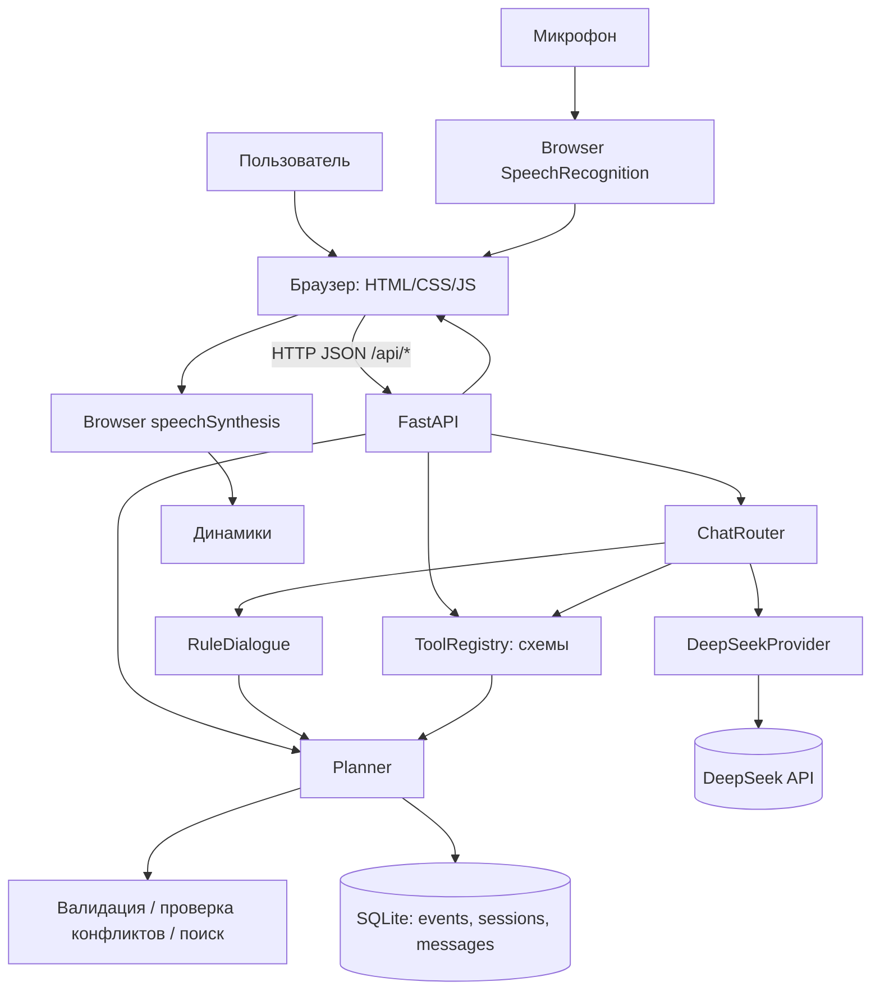

# Ритм — техническая документация

**Версия документа:** 1.1
**Дата:** 31 октября 2026 г.
**Объект документирования:** текущий исходный код репозитория
**Статус системы:** локальный прототип с `ChatRouter`, DeepSeek provider и детерминированным fallback. Реальный LiteRouter smoke-test через `/api/chat` успешно пройден.

> Этот документ описывает **реализованное состояние** приложения. Планируемые функции выделены отдельно и не считаются существующими. Документ составлен по Python/JavaScript-коду, SQL-схеме, тестам и конфигурации проекта.

## 1. Назначение и область применения

«Ритм» — однопользовательское локальное веб-приложение для учёта задач, встреч и напоминаний. Пользователь взаимодействует с ним через формы и расписание в браузере, текстовый чат либо диктовку команды в поддерживаемом браузере.

Приложение решает следующие задачи:

- создание, просмотр, редактирование и отмена событий;
- фильтрация событий по датам и типу;
- лексический и нечёткий поиск существующих записей;
- обнаружение пересечений встреч по времени;
- хранение записей и истории диалога в SQLite;
- загрузка исходного CSV-набора из 1000 записей;
- обработка русскоязычных команд через правила и свободных формулировок через DeepSeek;
- публикация и безопасное выполнение JSON-схем шести инструментов;
- уточнения, выбор среди совпадений, синонимы поиска и отдельное подтверждение отмены.

**Существенное уточнение:** браузерные уведомления о наступивших событиях реализованы через опрос API и Service Worker при открытой вкладке. Мгновенная доставка после закрытия вкладки через Web Push **не реализована**.

## 2. Состояние функциональности

| Подсистема | Реализация | Статус |
|---|---|---|
| CRUD событий | `Planner`, REST API, веб-форма | Реализовано |
| Типы `task`, `meeting`, `reminder` | Pydantic + SQLite | Реализовано |
| Конфликты встреч | Проверка временных интервалов в UTC | Реализовано |
| Поиск | Нормализация, fuzzy similarity | Реализовано; не семантический |
| Импорт CSV | Идемпотентный импорт | Реализовано |
| Текстовый чат | `ChatRouter`, `RuleDialogue`, DeepSeek provider | Реализовано; LLM опциональна |
| Диктовка | Browser Web Speech API | Зависит от браузера |
| Озвучивание | Browser `speechSynthesis` | Опционально |
| Инструменты для агента | `ToolRegistry` с 6 операциями | Контракты и исполнитель готовы |
| LLM | OpenAI-совместимый DeepSeek tool calling + model-neutral `LLMProvider` | Реализовано; LiteRouter smoke-test пройден |
| Skills / `SKILL.md` | Нет реестра, матчера и загрузчика | Не реализовано |
| Браузерные уведомления | Опрос `/api/notifications/due`, Notification API, Service Worker | Реализовано при открытой вкладке; Web Push нет |
| Полностью локальные STT/TTS | Нет Whisper/Silero | Не реализовано |
| Память LLM и compaction | Есть история сообщений, нет summarization | Не реализовано |
| Повторяющиеся события | Нет recurrence-модели | Не реализовано |
| Внешние календари | Нет интеграции | Не реализовано |
| Аутентификация | Нет | Не реализовано |

## 3. Технологический стек

| Уровень | Технологии |
|---|---|
| Язык серверной части | Python 3.11+ |
| HTTP-сервер и API | FastAPI, Uvicorn |
| Схемы и проверка входных данных | Pydantic 2 |
| Хранилище | SQLite (`sqlite3` из стандартной библиотеки Python) |
| Временные зоны | `zoneinfo`, `tzdata`, IANA time zones |
| Поиск | Python `re`, `unicodedata`, `difflib.SequenceMatcher` |
| Интерфейс | React, Vite, HTML, CSS, JavaScript |
| Распознавание речи | `SpeechRecognition` / `webkitSpeechRecognition` браузера |
| Синтез речи | `SpeechSynthesisUtterance` браузера |
| Автоматические тесты | pytest, FastAPI `TestClient`, httpx |
| CI | GitHub Actions, Python 3.11/3.12/3.13 |

**Внешняя LLM опциональна:** при `DEEPSEEK_API_KEY` или пуле `DEEPSEEK_API_KEYS` используется DeepSeek, без ключей — только локальные правила. Локальный `.env` загружается через `python-dotenv`; отдельной СУБД или Node.js не требуется.

## 4. Архитектура

### 4.1. Логическая схема



### 4.2. Границы ответственности

**Интерфейс (`web/`)** отображает события, передаёт JSON-запросы и управляет браузерным голосом. Бизнес-правила здесь не должны дублироваться.

**API (`assistant/api.py`)** валидирует HTTP-входы, связывает маршруты с сервисами и отображает ошибки на HTTP-коды. Содержит фабрику `create_app(settings, llm_provider=..., deepseek_client=...)` и объект `app = create_app()`.

**Диалоговый слой (`assistant/routing.py`)** — `ChatRouter`: LLM-first для новых сообщений, локальный fallback, pending-уточнения, выбор записи и подтверждение отмены. `RuleDialogue` из `assistant/dialogue.py` сохраняет детерминированные команды и обращается к Planner непосредственно.

**LLM-слой (`assistant/deepseek.py`, `assistant/deepseek_provider.py`)** вызывает DeepSeek и преобразует tool call в `ParsedCommand`, не выполняя операцию. Read-only результат может быть описан моделью; мутации подтверждает сервер.

**Реестр инструментов (`assistant/tools.py`)** выдаёт описания функций в формате `type=function` и выполняет строго валидированные вызовы `Planner` в LLM-сценариях.

**Бизнес-слой (`assistant/service.py`)** — `Planner`, основной источник доменных правил: CRUD, время, конфликты, поиск, импорт, состояние диалогов.

**Хранилище (`assistant/database.py`)** — схема SQLite, соединения, транзакции, индексы и WAL. SQL не предоставляется модели как инструмент.

## 5. Структура проекта

```text
ritm/
├── assistant/
│   ├── __init__.py
│   ├── api.py             # HTTP-маршруты, запуск приложения
│   ├── config.py          # настройки и переменные окружения
│   ├── contracts.py       # LLMContext, ParsedCommand, RouteDecision
│   ├── database.py        # схема SQLite, соединения, транзакции
│   ├── dates.py           # парсер русских дат и периодов
│   ├── deepseek.py        # HTTP-клиент DeepSeek
│   ├── deepseek_provider.py # DeepSeek tool calls -> ParsedCommand
│   ├── dialogue.py        # RuleDialogue, уточнения и шаблоны команд
│   ├── llm_provider.py    # model-neutral Protocol и NullLLMProvider
│   ├── models.py          # модели и ограничения Pydantic
│   ├── routing.py         # ChatRouter и pending-состояния
│   ├── search.py          # лексический и нечёткий поиск
│   ├── service.py         # Planner: доменная логика
│   └── tools.py           # ToolRegistry: 6 инструментов
├── data/
│   └── events.csv         # исходные записи для импорта
├── web/
│   ├── index.html         # интерфейс
│   ├── styles.css         # оформление
│   └── app.js             # запросы к API и голос
├── tests/
│   ├── conftest.py
│   ├── test_api.py
│   ├── test_dates_dialogue.py
│   ├── test_deepseek.py
│   ├── test_full_seed.py
│   ├── test_llm_boundary.py
│   ├── test_routing.py
│   ├── test_service.py
│   └── test_tools.py
├── .github/workflows/tests.yml
├── .env.example
├── .gitignore
├── ARCHITECTURE.md
├── DEMO_CHECKLIST.md
├── README.md
├── pytest.ini
├── requirements.txt
├── requirements-dev.txt
├── run.py
└── start_windows.bat
```

Файл `assistant.db` появляется при запуске приложения и не включён в исходный архив; он исключён из Git через `.gitignore`.

## 6. Жизненный цикл приложения

1. Пользователь запускает `start_windows.bat` или `python run.py`.
2. Uvicorn импортирует `assistant.api:app`.
3. `create_app()` читает `Settings` из переменных окружения.
4. Создаётся `Database`, и при необходимости создаются таблицы и индексы SQLite.
5. Создаётся `Planner` с часовым поясом по умолчанию.
6. Если импорт включён, `Planner.import_csv()` читает `data/events.csv`; уже импортированные записи пропускаются.
7. Создаются `RuleDialogue` и `ToolRegistry`; приложение регистрирует HTTP-маршруты.
8. Браузер обращается к `GET /`, загружает `/static/*` и взаимодействует с `/api/*`.
9. Изменения событий выполняются транзакционно и сохраняются в `assistant.db`.

По умолчанию Uvicorn слушает **`127.0.0.1:8000`**, то есть только локальный loopback-интерфейс.

## 7. Доменная модель и бизнес-правила

### 7.1. Сущность Event

| Поле | Тип / назначение |
|---|---|
| `id` | Числовой первичный ключ |
| `kind` | `task`, `meeting`, `reminder` |
| `title` | Обязательная строка, после нормализации 1–500 символов |
| `scheduled_date` | Дата `YYYY-MM-DD`, может отсутствовать у задачи |
| `scheduled_time` | Локальное время с точностью до минуты |
| `duration_minutes` | Длительность встречи, 1–1440 минут; по умолчанию 60 |
| `timezone` | IANA-имя часового пояса записи |
| `status` | `open`, `done`, `cancelled` |
| `created_at`, `updated_at` | Отметки времени в UTC, сериализуются в ISO 8601 |
| `source` | Источник, например `manual` или `csv` |
| `external_id` | Исходный ID импортированной записи; внутреннее поле SQLite |
| `version` | Версия записи для оптимистической блокировки |
| `notified_at` | UTC-время выдачи события браузеру для уведомления; `NULL` — ещё не выдано |

### 7.2. Инварианты

- **Задача (`task`)** может не иметь даты/времени; время без даты недопустимо.
- **Встреча (`meeting`)** требует дату и время. Если длительность не задана, используется **60 минут**.
- **Напоминание (`reminder`)** требует дату и время. Открытая вкладка получает наступившее событие через `/api/notifications/due`; без вкладки запись сама не инициирует доставку.
- Длительность разрешена только для встреч.
- Пустое название и неразрешённые дополнительные поля отклоняются Pydantic-моделями.
- У создаваемого события исходный статус `open`.
- Активные встречи не могут пересекаться по временному интервалу; сравнение проводится в UTC, включая события, переходящие через полночь.
- Событие со статусом `cancelled` физически не удаляется; оно скрыто из обычных списков, но доступно по ID и через `include_cancelled=true`.
- При изменении можно передать `expected_version`. Если версия устарела, возвращается конфликт. После успешного изменения версия увеличивается на 1.
- `EventPatch` не поддерживает очистку даты или времени передачей `null`.
- Тип события `kind` и часовой пояс нельзя изменить через существующий `PATCH`-контракт.

### 7.3. Часовые пояса и DST

По умолчанию `Europe/Moscow`; можно изменить `ASSISTANT_TIMEZONE`. Записи хранят исходное локальное время и IANA-зону. Внутри проверки пересечений момент преобразуется в UTC.

Несуществующее локальное время при сезонном переводе часов отвергается. Неоднозначное локальное время осеннего перевода разрешается первым вхождением (`fold=0`). Изменение настройки пояса после первого импорта **не переводит старые записи**: их `timezone` уже сохранён.

## 8. Физическая схема SQLite

База по умолчанию: `ritm/assistant.db`. `PRAGMA user_version=1`. Режим журнала — **WAL**; включены внешние ключи и ожидание блокировки до 15 секунд. Запись оборачивается в `BEGIN IMMEDIATE` с `COMMIT`/`ROLLBACK`.

### 8.1. Таблица `events`

| Столбец | SQLite-тип | Особенности |
|---|---|---|
| `id` | INTEGER | PK AUTOINCREMENT |
| `kind` | TEXT | CHECK: `task`, `meeting`, `reminder` |
| `title` | TEXT | NOT NULL; непустое |
| `scheduled_date` | TEXT | ISO-дата, nullable |
| `scheduled_time` | TEXT | Локальное время, nullable |
| `duration_minutes` | INTEGER | nullable |
| `timezone` | TEXT | NOT NULL |
| `status` | TEXT | NOT NULL, default `open` |
| `created_at` | TEXT | NOT NULL |
| `updated_at` | TEXT | NOT NULL |
| `source` | TEXT | default `manual` |
| `external_id` | TEXT | Уникальность в паре с `source` |
| `version` | INTEGER | NOT NULL, default 1 |

Индексы: `idx_events_date(scheduled_date, scheduled_time)`, `idx_events_kind_date(kind, scheduled_date)`, `idx_events_status(status)`. Ограничение `UNIQUE(source, external_id)` предотвращает дубли CSV при повторном импорте.

### 8.2. Таблица `sessions`

| Столбец | Значение |
|---|---|
| `id` | Строковый первичный ключ сессии |
| `active_event_id` | ID последнего однозначно выбранного события; внешний ключ на `events` |
| `pending_action` | Незавершённое действие, например `create_event` |
| `pending_data` | JSON с уже известными аргументами |
| `updated_at` | Дата изменения состояния |

### 8.3. Таблица `messages`

| Столбец | Значение |
|---|---|
| `id` | Числовой PK AUTOINCREMENT |
| `session_id` | Внешний ключ на `sessions` |
| `role` | `user`, `assistant` или `tool` |
| `content` | Текст сообщения |
| `created_at` | Отметка времени в UTC |

Индекс `idx_messages_session(session_id, id)`. В текущем RuleDialogue записываются сообщения `user` и `assistant`; инфраструктура таблицы допускает `tool`, но агентного исполнения в чате нет. Отдельной таблицы summary нет.

### 8.4. Полезные SQL-запросы для диагностики

```sql
-- Количество всех событий, включая отменённые
SELECT COUNT(*) FROM events;

-- Распределение по типам и статусам
SELECT kind, status, COUNT(*) AS total
FROM events
GROUP BY kind, status
ORDER BY kind, status;

-- Следующие активные встречи
SELECT id, title, scheduled_date, scheduled_time, timezone, version
FROM events
WHERE kind = 'meeting' AND status = 'open'
ORDER BY scheduled_date, scheduled_time
LIMIT 30;

-- Последние сообщения
SELECT session_id, role, content, created_at
FROM messages
ORDER BY id DESC
LIMIT 30;
```

Для чтения удобны SQLite Viewer в VS Code или DB Browser for SQLite. При ручной модификации базы остановите сервер и создайте резервную копию.

## 9. HTTP API

**Базовый адрес:** `http://127.0.0.1:8000`  
**Интерактивная документация OpenAPI:** `GET /docs`  
**Формат:** JSON, кроме HTML и статических ресурсов.

| Метод | Маршрут | Назначение |
|---|---|---|
| `GET` | `/api/health` | `status`, `llm_connected`, `llm_configured`, `llm_model`, `timezone`, `records` |
| `POST` | `/api/events` | Создать событие (`EventCreate`), ответ 201 |
| `GET` | `/api/events` | Получить список с фильтрами, `items` и `total` |
| `GET` | `/api/events/{event_id}` | Получить событие по ID |
| `PATCH` | `/api/events/{event_id}` | Изменить событие, кроме отмены без подтверждения |
| `POST` | `/api/events/{event_id}/cancel-request` | Начать двухшаговую отмену с `session_id` |
| `DELETE` | `/api/events/{event_id}` | Deprecated: возвращает 409, прямая отмена запрещена |
| `GET` | `/api/search` | Лексический/fuzzy поиск |
| `POST` | `/api/chat` | Диалог через `ChatRouter`, правила и опциональный DeepSeek |
| `GET` | `/api/sessions/{session_id}/history` | История сообщений сессии |
| `GET` | `/api/tools` | JSON Schema доступных инструментов |
| `GET` | `/` | HTML-интерфейс |
| `GET` | `/static/*` | CSS/JavaScript и статические ресурсы |

### 9.1. Фильтры и ограничения

**`GET /api/events`** принимает `from_date`, `to_date` (включительно), `kind`, `include_cancelled` (по умолчанию `false`), `limit` (1–200, по умолчанию 100), `offset` (от 0). События без даты попадают в общий список, но не в выборку по датам.

**`GET /api/search`** принимает `q` (2–500 символов), `kind`, `limit` (1–100, по умолчанию 20). Ответ содержит `strategy: "lexical_fuzzy"`.

**`POST /api/chat`** принимает `message` (1–2000 символов) и `session_id` (по умолчанию `default`, длина 1–80, латинские буквы/цифры/`_`/`-`). Ответ содержит `answer`, `session_id`, `action`, `event`, `events`, `needs_llm` и `mode` (`deepseek`/`fallback`).

**`GET /api/sessions/{session_id}/history`** принимает `limit` (1–200, по умолчанию 50).

### 9.2. Примеры вызовов

Создание встречи:

```http
POST /api/events HTTP/1.1
Content-Type: application/json

{
  "kind": "meeting",
  "title": "Планёрка команды",
  "scheduled_date": "2026-11-05",
  "scheduled_time": "15:00",
  "duration_minutes": 45,
  "timezone": "Europe/Moscow"
}
```

Поиск событий по периоду:

```http
GET /api/events?from_date=2026-11-01&to_date=2026-11-07&kind=meeting
```

Перенос существующего события (ID и версия берутся из актуального ответа сервера):

```http
PATCH /api/events/1001 HTTP/1.1
Content-Type: application/json

{
  "scheduled_date": "2026-11-06",
  "scheduled_time": "16:00",
  "expected_version": 1
}
```

Запрос к диалоговому режиму:

```http
POST /api/chat HTTP/1.1
Content-Type: application/json

{
  "session_id": "demo",
  "message": "Добавь встречу с Иваном завтра"
}
```

Если время не указано, ответ имеет `action: "clarify"`; следующий запрос с тем же `session_id`, например `"в 15:00"`, продолжает создание.

### 9.3. Обработка ошибок

| Код | Причина |
|---|---|
| `404 Not Found` | Событие с запрошенным ID не найдено |
| `409 Conflict` | Пересекающиеся встречи или несовпадение `expected_version` |
| `422 Unprocessable Entity` | Невалидный JSON/параметры, нарушение доменных правил, неверные даты |
| `500 Internal Server Error` | Необработанная ошибка приложения; требует диагностики |

Все операции создания и изменения проходят доменную проверку в `Planner`, а не только клиентскую форму.

## 10. Инструменты (`ToolRegistry`)

`GET /api/tools` предоставляет схемы для LLM-adapter. **Этот HTTP-маршрут только читает спецификации и не выполняет инструменты.** Вызов `ToolRegistry.execute(name, arguments, confirmed_by_user=False)` доступен внутри Python-приложения и используется `ChatRouter`.

| Инструмент | Аргументы | Назначение |
|---|---|---|
| `create_event` | `kind`, `title`, дата, время, длительность | Создать задачу, встречу или напоминание |
| `list_events` | `from_date`, `to_date`, `kind`, `limit` | Перечислить события |
| `search_events` | `query`, `kind`, `limit` | Поиск по содержимому |
| `get_event` | `event_id` | Получение по ID |
| `update_event` | `event_id`, изменяемые поля, `expected_version` | Изменение записи |
| `cancel_event` | `event_id`, `expected_version` | Мягкая отмена |

Входы проверяются Pydantic-моделями с `extra="forbid"`. Неизвестные инструменты и лишние параметры отклоняются; сырых SQL/Python-инструментов нет. Результат — словарь с `ok: true/false` и данными либо кодом ошибки (`invalid_arguments`, `not_found`, `conflict`, `domain_error`, `confirmation_required`, `unknown_tool`).

**Защита отмены:** `cancel_event` не исполняется без отдельного серверного `confirmed_by_user=True`; модель не может передать этот флаг внутри JSON-аргументов. `update_event(status=cancelled)` также отклоняется. REST `DELETE` и `PATCH status=cancelled` возвращают 409. UI и чат используют `cancel-request`/`confirm_cancel`, отдельное «да»/«нет» и закреплённую `expected_version`.

## 11. Диалог и обработка естественного языка

### 11.1. `RuleDialogue`

`RuleDialogue.process(message, session_id)` исполняет детерминированный сценарий:

1. Загружает состояние `sessions`.
2. Если ожидается уточнение при создании встречи/напоминания, объединяет уже известные поля с новой датой/временем.
3. В противном случае проверяет шаблоны поиска, получения планов, отметки выполнения, переноса и создания.
4. Для операций обращается к `Planner`.
5. Сохраняет исходный текст и ответ в `messages`.
6. Возвращает `ChatOutput` с результатом.

Примеры поддерживаемых формулировок: «Напомни завтра в 10 утра позвонить Ивану», «Добавь встречу с командой завтра» → «в 15:00», «Что у меня сегодня?», «Найди задачу про договор», «Перенеси её на пятницу» после однозначного выбора события.

При настроенном `LLMProvider` каждое новое сообщение сначала передаётся модели, включая простые команды. При ответе `unknown`, ошибке интерпретации или недоступности провайдера `ChatRouter` вызывает локальные правила и FreeFormParser. Без провайдера используется только детерминированный резерв; если и он не распознал команду, возвращается `action: "unrecognized"`, `needs_llm: true` без фиксации действия.

Контекст представлен `sessions.active_event_id` и `sessions.pending_action`/`pending_data`. Поддерживаются `create_event`, `complete_command`, `select_event` и `confirm_cancel`: уточнение полей, выбор среди совпадений и отдельное подтверждение отмены. Это серверная рабочая память, а не передача полной истории в LLM.

### 11.2. Парсер дат `dates.py`

Распознаёт часть русских выражений: `сегодня`, `завтра`, `послезавтра`, `через N часов/минут/дней`, день недели, `до конца недели`, дату вида `YYYY-MM-DD`, `DD.MM`, `DD.MM.YYYY`, время `15:00`, `в 10 утра`, `в 5 вечера`. Периоды «эта неделя» и «следующая неделя» интерпретируются в указанном часовом поясе. Неподдержанные формулировки не преобразуются произвольно.

## 12. Алгоритм поиска

Файлы: `assistant/search.py` и метод `Planner.search()`.

1. Запрос нормализуется (`NFKC`, нижний регистр, замена `ё` на `е`).
2. Строка разбивается на слова; служебные слова исключаются.
3. Для слов запроса и заголовка события рассчитываются степени сходства: точное совпадение, совпадение первых четырёх символов длинных слов или `SequenceMatcher`.
4. Агрегируется оценка покрытия и совпавших токенов; записи ранжируются по убыванию оценки.
5. По умолчанию отменённые события исключаются.

**Основной поиск лексический:** векторные представления, embeddings и внешний поисковый движок не используются. После пустого результата DeepSeek может предложить до пяти синонимов, но повторный поиск снова выполняется локальным алгоритмом. Реализация загружает подходящие записи из SQLite и вычисляет оценки в Python, поэтому стоимость растёт с числом записей. Для текущих 1000 CSV-записей этого достаточно для прототипа.

## 13. Голосовой интерфейс

### 13.1. Ввод

В `web/app.js` используется `window.SpeechRecognition || window.webkitSpeechRecognition`. Устанавливаются `lang='ru-RU'`, `interimResults=false`, `maxAlternatives=1`. При нажатии кнопки микрофона браузер запрашивает доступ к устройству, распознаёт одну реплику и помещает транскрипцию в поле чата.

**Команда не отправляется автоматически после распознавания.** Пользователь отправляет заполненное поле через форму. При отсутствии `SpeechRecognition` кнопка отключается. Используемый браузер может применять облачное распознавание — гарантии автономной STT нет.

### 13.2. Вывод

При включённой настройке «озвучивать ответы» используется `window.speechSynthesis` с `SpeechSynthesisUtterance`, `lang='ru-RU'`, `rate=1.04`. Для озвучивания берутся первые 800 символов ответа. Доступность и качество голоса зависят от браузера и ОС.

### 13.3. Взаимодействие с сервером

Цепочка: **микрофон → браузерный STT → текстовое поле → `POST /api/chat` → RuleDialogue → Planner → SQLite → ответ JSON → интерфейс → необязательное браузерное TTS**.

Не реализованы wake word, непрерывное прослушивание, потоковая передача аудио на Python-сервер, локальные Whisper/Silero, прерывание голоса пользователя ассистентом.

## 14. Веб-интерфейс

Основные функции `web/app.js`:

- запрос состояния сервера из `/api/health`;
- отображение событий за выбранную неделю, изменение диапазона дат и фильтра типа;
- поиск из формы через `/api/search`;
- загрузка списка с пагинацией (по 60 записей);
- модальная форма создания/изменения события;
- отметка выполнения, браузерное подтверждение отмены;
- текстовый чат и загрузка последних 40 сообщений;
- микрофон и опциональная озвучка.

В браузере `session_id` сохраняется в `localStorage` под ключом `ritm_session`. Этот идентификатор поддерживает продолжение диалога между обновлениями страницы, **но не является механизмом аутентификации**. При поиске через поле списка фильтры дат не отправляются на сервер: поиск выполняется по всем доступным неотменённым событиям с учётом выбранного типа.

## 15. Импорт CSV

В `data/events.csv` предусмотрены столбцы:

```csv
id,date,time,text
1,2024-01-07,14:45,Подготовить техническое задание
```

Импорт запускается при создании приложения, если `ASSISTANT_IMPORT_SEED=1`. Проверяются наличие полей, уникальность ID внутри CSV, корректность даты/времени, непустое название и допустимость локального времени.

Поскольку CSV не содержит тип события, **все записи импортируются как `task`** (`source='csv'`, исходный `external_id`). Весь импорт выполняется транзакционно. Сочетание `source`/`external_id` делает повторный запуск идемпотентным: записи не дублируются, ранее изменённые записи не перезаписываются.

В поставляемом файле — **1000** исходных записей. В уже используемой базе общее число событий может быть больше 1000, если пользователь создавал собственные записи, или меньше в другом окружении, если импорт отключён.

## 16. Установка и конфигурация

### 16.1. Требования

- Windows 10/11 (целевое окружение) или другая ОС с Python 3.11+;
- Python и `pip`;
- браузер для веб-интерфейса;
- интернет для первичной установки библиотек, если их нет в локальном кеше;
- разрешение на использование микрофона для диктовки.

### 16.2. Запуск на Windows

В корневой папке распакованного проекта:

```powershell
.\start_windows.bat
```

Этот скрипт выбирает `py` или `python`, создаёт `.venv` при отсутствии, активирует окружение, выполняет `pip install -r requirements.txt`, затем запускает `python run.py`.

Альтернативно:

```powershell
py -m venv .venv
.\.venv\Scripts\python.exe -m pip install -r requirements.txt
.\.venv\Scripts\python.exe run.py
```

Адрес интерфейса: <http://127.0.0.1:8000>. Swagger: <http://127.0.0.1:8000/docs>. Остановка сервера — `Ctrl+C`.

### 16.3. Переменные окружения

| Переменная | По умолчанию | Назначение |
|---|---|---|
| `ASSISTANT_DB` | `<корень проекта>/assistant.db` | Путь к SQLite-файлу |
| `ASSISTANT_TIMEZONE` | `Europe/Moscow` | IANA-зона для новых событий и относительных дат |
| `ASSISTANT_IMPORT_SEED` | `1` | Импортировать CSV при старте (`0` — отключить) |
| `ASSISTANT_SEED_CSV` | `<корень проекта>/data/events.csv` | Путь к исходному CSV |
| `DEEPSEEK_API_KEY` | пусто | Одиночный ключ (backward-compatible) |
| `DEEPSEEK_API_KEYS` | пусто | Ключи через запятую для auth/quota failover |
| `DEEPSEEK_BASE_URL` | `https://api.literouter.com/v1` | OpenAI-совместимый endpoint |
| `DEEPSEEK_MODEL` | `deepseek-v4.1-flash-1017:free` | Идентификатор модели |
| `DEEPSEEK_TIMEOUT_SECONDS` | `30` | Timeout одного HTTP-запроса |

Пример PowerShell для текущего окна терминала:

```powershell
$env:ASSISTANT_TIMEZONE = 'Europe/London'
$env:ASSISTANT_DB = 'D:\IntelliJ Projects\ritm\assistant.db'
.\.venv\Scripts\python.exe run.py
```

`.env` загружается автоматически из корня проекта через `python-dotenv`; реальные переменные окружения имеют приоритет. `.env.example` — образец без секретов, а `.env` исключён через `.gitignore`. После редактирования требуется перезапуск. При 401/402/403/429 выполняется failover на следующий слот `DEEPSEEK_API_KEYS`; 429 получает cooldown по `Retry-After` или 60 секунд. На timeout, 5xx и доменные ошибки ключи не переключаются.

## 17. Проверка и тестирование

Тестовые зависимости:

```powershell
.\.venv\Scripts\python.exe -m pip install -r requirements-dev.txt
.\.venv\Scripts\python.exe -m pytest -q
```

Набор тестов проверяет REST, схемы инструментов, CRUD, конфликты встреч, оптимистические версии, DST, парсинг дат, уточняющий диалог, историю, поиск, повторный импорт CSV, LLM-границу и DeepSeek через mocks. Фикстуры используют временные SQLite-базы и не изменяют рабочую `assistant.db`.

**Результат локальной проверки 31.10.2026:** `68 passed`; реальный LiteRouter запрос через автоматически загруженный `.env` и `/api/chat` создал запись и получил `llm_connected=true`. Отдельный failover-тест с недействительным первым ключом успешно переключился на второй слот. GitHub Actions настроен на Python 3.11, 3.12 и 3.13 без сетевых LLM-вызовов.

### 17.1. Ручная приёмочная проверка

1. Запустить сервер и открыть `/api/health`: без ключа `llm_configured=false`, `llm_connected=false`; после успешного DeepSeek-вызова `llm_connected=true`.
2. В свежей БД проверить импорт 1000 записей и отсутствие дублей после перезапуска.
3. Создать встречу и попытаться создать вторую, пересекающую её: ожидать HTTP 409.
4. Создать задачу, отметить выполненной, перезапустить сервер и проверить сохранение статуса.
5. Проверить поиск по изменённой словоформе, например «договору».
6. В диалоге создать встречу без времени, ответить на уточняющий вопрос.
7. Проверить перенос выбранной встречи на другую дату.
8. Проверить историю сессии, отмену события и `GET /api/tools`.
9. Проверить диктовку и озвучку в поддерживаемом браузере отдельно от бэкенд-тестов.

## 18. Безопасность, надёжность и ограничения

### 18.1. Реализованные меры

- Pydantic-проверки входных аргументов и запрет дополнительных полей для `EventCreate`, `EventPatch`, tool-аргументов.
- Параметризованные SQL-запросы к пользовательским значениям.
- Транзакции `BEGIN IMMEDIATE` для согласованности записи и проверки конфликтов.
- Оптимистическое версионирование `expected_version`.
- Мягкая отмена вместо физического удаления.
- Отдельный серверный флаг подтверждения при вызове `cancel_event` **через ToolRegistry**.
- Локальный bind сервера на `127.0.0.1` по умолчанию; при Render `PORT` или явном `HOST=0.0.0.0` используется внешний интерфейс.

### 18.2. Известные ограничения текущей версии

- **Нет аутентификации и разделения пользователей**; `session_id` не защищает данные от чужого клиента с доступом к API.
- **Нет TLS, лимитов запросов и промышленного контроля доступа**. Не открывать сервер в интернет без дополнительных мер.
- **Нет доставки в закрытую вкладку**: браузерный polling и Service Worker показывают события при открытом приложении, но Web Push и независимый фоновый будильник отсутствуют.
- **DeepSeek требует сеть и действующий ключ**; free-модель может иметь лимиты и зависеть от доступности LiteRouter. Skills/SkillRegistry нет.
- **Нет гарантированно офлайн-распознавания речи**; браузер может обращаться к сетевому сервису.
- **Нет семантического поиска, embeddings, контекстной суммаризации и compaction**.
- **Нет повторяющихся событий, внешней календарной синхронизации и многопользовательского режима**.
- **Нет отдельного процесса обслуживания задач после закрытия сервера**.
- **Миграции SQLite ограничены текущей схемой**: есть переход `user_version` 1 → 2 для `notified_at` и проверка на более новую версию, но нет полноценного migration-runner.
- **Ограниченная обработка свободного русского языка** в `RuleDialogue` и регулярных выражениях.
- **Нет механизма резервного копирования в UI**; резервные копии нужно создавать отдельно.

## 19. Диагностика неполадок

| Симптом | Что проверить |
|---|---|
| `http://127.0.0.1:8000` недоступен | Запущен ли `start_windows.bat` / `python run.py`; свободен ли порт 8000 |
| База не появилась | Проверить `ASSISTANT_DB`, права записи и фактический путь процесса |
| Нет 1000 записей | Проверить `ASSISTANT_IMPORT_SEED`, `ASSISTANT_SEED_CSV`, свежесть базы; `/api/health` |
| Время не то | Проверить `ASSISTANT_TIMEZONE` и `timezone` уже сохранённых событий |
| Ошибка 409 при встрече | Проверить существующие активные встречи в пересекающемся интервале |
| Ошибка 409 при редактировании | Загрузить актуальную `version` записи и повторить действие |
| Не работает микрофон | Проверить браузер, разрешение на микрофон, наличие Web Speech API и соединение, если браузерное STT облачное |
| Фраза не распознана как команда | Проверить `DEEPSEEK_API_KEY`/`DEEPSEEK_API_KEYS`, `/api/health`, сеть и лимиты API; без LLM упростить формулировку для `RuleDialogue` |
| Напоминание не появилось | Вкладка должна быть открыта; проверить HTTPS, разрешение сайта на уведомления, `/api/notifications/due` и ошибки опроса в шапке |

## 20. Точки расширения (не реализованы)

Следующие компоненты могут быть добавлены без переписывания существующего `Planner`:

1. **Дополнительные LLM providers и agent runtime**: история диалога в контексте, цепочки нескольких tool calls, лимиты шагов и расширенное логирование поверх существующей границы `LLMProvider`.
2. **SkillRegistry / SkillMatcher / SkillLoader**: чтение `SKILL.md`, выбор релевантного навыка, передача его инструкций агенту. Сейчас таких модулей нет.
3. **Web Push / независимый Reminder Scheduler**: доставка после закрытия вкладки, push-подписки, VAPID, очередь и подтверждение доставки. Текущий polling с защитой от повторов через `notified_at` этого не заменяет.
4. **Локальные STT/TTS**: замена браузерного голоса на локальные сервисы без изменения CRUD-логики.
5. **Context Manager**: окно свежих сообщений, отдельные summary-записи, правила compaction и восстановления исходной истории.
6. **Семантический поиск**: индекс embeddings с последующей проверкой исходных событий в SQLite.
7. **Production-hardening**: авторизация, безопасность HTTP, миграции, резервное копирование, метрики и тесты под нагрузкой.

## 21. Итог

Текущая версия «Ритма» — **рабочий локальный органайзер с опциональным DeepSeek tool calling**. Ядро составляют `ChatRouter`, `Planner`, Pydantic-модели, SQLite, REST API и шесть безопасно валидируемых инструментов. Без модели продолжают работать формы, REST и ограниченный RuleDialogue. Реальный LiteRouter smoke-test пройден; следующие этапы — расширение диалогового контекста, настоящая доставка напоминаний и полностью локальный голос.

---

**Основание документации:** текущий репозиторий «Ритма», включая `README.md`, `ARCHITECTURE.md`, `LLM_INTEGRATION.md`, `assistant/*.py`, `web/*`, `tests/*`, `.env.example`, `requirements*.txt` и GitHub Actions workflow.
